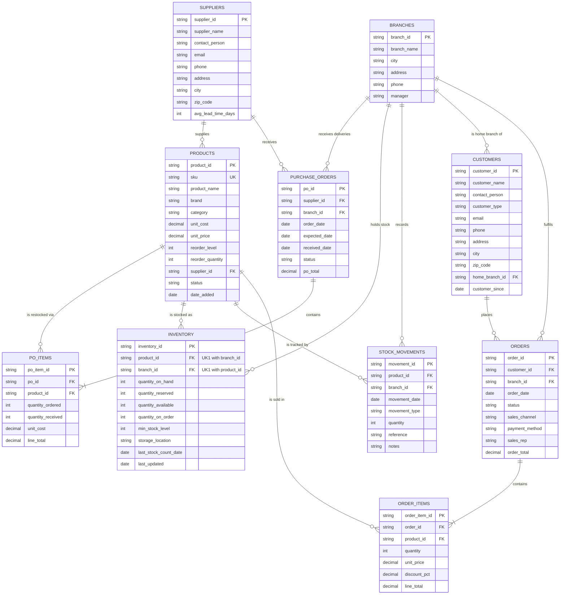

# Entity-Relationship Diagram — TechNest Computers Inventory

Sample business: a computer store with **three branches (Tel Aviv, Jerusalem, Ariel)** selling laptops, desktops, tablets / iPads, monitors, peripherals, storage, networking gear, printers, accessories and software licenses. All sample data is fictional. A draw.io version of this diagram is in `ER.drawio`.

## Diagram

## Keys

| Table (Excel file → sheet) | Primary key | Foreign keys | Alternate (unique) keys |
|---|---|---|---|
| BRANCHES (`branches.xlsx` → Branches) | `branch_id` | — | — |
| SUPPLIERS (`suppliers.xlsx` → Suppliers) | `supplier_id` | — | — |
| PRODUCTS (`products.xlsx` → Products) | `product_id` | `supplier_id` → SUPPLIERS | `sku` |
| CUSTOMERS (`customers.xlsx` → Customers) | `customer_id` | `home_branch_id` → BRANCHES | `email` |
| ORDERS (`orders.xlsx` → Orders) | `order_id` | `customer_id` → CUSTOMERS, `branch_id` → BRANCHES | — |
| ORDER_ITEMS (`orders.xlsx` → Order_Items) | `order_item_id` | `order_id` → ORDERS, `product_id` → PRODUCTS | (`order_id`, `product_id`) |
| PURCHASE_ORDERS (`purchase_orders.xlsx` → Purchase_Orders) | `po_id` | `supplier_id` → SUPPLIERS, `branch_id` → BRANCHES | — |
| PO_ITEMS (`purchase_orders.xlsx` → PO_Items) | `po_item_id` | `po_id` → PURCHASE_ORDERS, `product_id` → PRODUCTS | — |
| INVENTORY (`inventory.xlsx` → Inventory) | `inventory_id` | `product_id` → PRODUCTS, `branch_id` → BRANCHES | (`product_id`, `branch_id`) |
| STOCK_MOVEMENTS (`inventory.xlsx` → Stock_Movements) | `movement_id` | `product_id` → PRODUCTS, `branch_id` → BRANCHES | — |

`inventory.xlsx` also holds **Stock_By_Brand_Category** (for example HP + Laptops: 33 on shelves, 3 ordered, 30 available — 16 Tel Aviv, 8 Jerusalem, 6 Ariel). It is a derived snapshot, not part of the model; the dashboard recomputes it live from the other sheets.

## Design notes

- **Inventory has one row per product *and* branch.** "HP laptops: 30 available" is a roll-up: the dashboard sums the rows. The branch split (16 / 8 / 6) is simply those rows grouped by `branch_id`.
- **Stock identity (always true):** `quantity_on_hand` = sum of `Stock_Movements.quantity` for that product and branch. `quantity_available` = `quantity_on_hand` − `quantity_reserved`.
- `quantity_reserved` = units on orders with status *Processing* at that branch (ordered by a customer, not yet handed over).
- `quantity_on_order` = units on purchase orders with status *Ordered* that are delivering to that branch.
- `min_stock_level` is each branch's own reorder trigger (a share of the product's company-wide `reorder_level`).
- Pricing columns (`unit_cost`, `unit_price`, `order_total`…) exist because a real store keeps them, but the inventory dashboard does not display them.
- **Movement types:** Opening Balance, Purchase Received (+), Sale (−), Customer Return (+), Adjustment (±).
