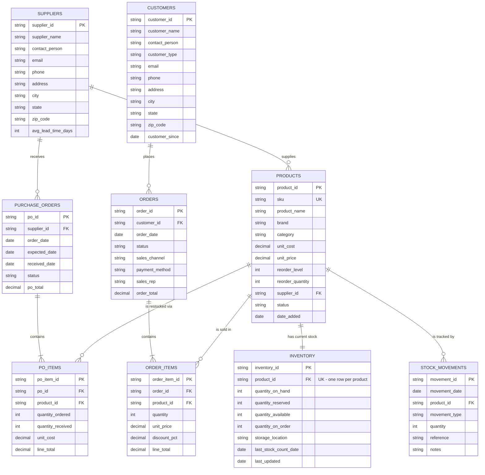

# Entity-Relationship Diagram — TechNest Computers Inventory

Sample business: a small computer store selling laptops, desktops, tablets / iPads, monitors, peripherals, storage, networking gear, printers, accessories and software licenses. All sample data is fictional.

## Diagram

## Keys

| Table (Excel file → sheet) | Primary key | Foreign keys | Alternate (unique) keys |
|---|---|---|---|
| SUPPLIERS (`suppliers.xlsx` → Suppliers) | `supplier_id` | — | — |
| PRODUCTS (`products.xlsx` → Products) | `product_id` | `supplier_id` → SUPPLIERS | `sku` |
| CUSTOMERS (`customers.xlsx` → Customers) | `customer_id` | — | `email` |
| ORDERS (`orders.xlsx` → Orders) | `order_id` | `customer_id` → CUSTOMERS | — |
| ORDER_ITEMS (`orders.xlsx` → Order_Items) | `order_item_id` | `order_id` → ORDERS, `product_id` → PRODUCTS | (`order_id`, `product_id`) |
| PURCHASE_ORDERS (`purchase_orders.xlsx` → Purchase_Orders) | `po_id` | `supplier_id` → SUPPLIERS | — |
| PO_ITEMS (`purchase_orders.xlsx` → PO_Items) | `po_item_id` | `po_id` → PURCHASE_ORDERS, `product_id` → PRODUCTS | — |
| INVENTORY (`inventory.xlsx` → Inventory) | `inventory_id` | `product_id` → PRODUCTS | `product_id` (1:1) |
| STOCK_MOVEMENTS (`inventory.xlsx` → Stock_Movements) | `movement_id` | `product_id` → PRODUCTS | — |

`inventory.xlsx` also holds a convenience sheet, **Stock_By_Brand_Category** (e.g. HP + Laptops = 24 units on hand). It is a derived snapshot, not a table in the model; the dashboard recomputes it live.

## Design notes

- **Inventory is one row per product (SKU), not per brand.** "HP computers: 12 left" is a roll-up, so the dashboard sums `quantity_on_hand` across the HP products to get it. This keeps each model's stock, reorder level and cost separate.
- **Stock identity (must always hold):** `quantity_on_hand` = sum of `Stock_Movements.quantity` for the product. `quantity_available` = `quantity_on_hand` − `quantity_reserved`.
- `quantity_reserved` = units on orders with status *Processing* (not yet shipped).
- `quantity_on_order` = units on purchase orders with status *Ordered* (not yet received).
- `order_items.unit_price` is the price at time of sale, so later price changes do not rewrite history.
- **Movement types:** Opening Balance, Purchase Received (+), Sale (−), Customer Return (+), Adjustment (±).
